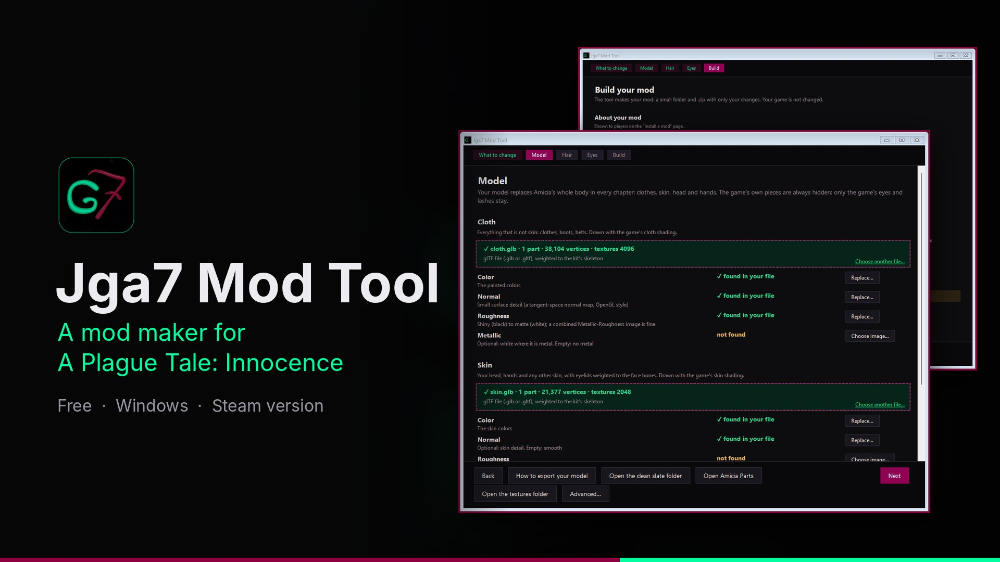

# Jga7 Mod Tool

Make, install and restore Amicia mods for A Plague Tale: Innocence (Steam). Free Windows tool by Jga7.

**Website:** https://jga7o.github.io/jga7-mod-tool/

**Download:**
- Gumroad: https://jga7.gumroad.com/l/ludzha
- Nexus Mods: https://www.nexusmods.com/aplaguetaleinnocence/mods/48
- GitHub: https://github.com/Jga7o/jga7-mod-tool/releases/latest

The character in the pictures is an example made with this tool. It does not come with the tool: the tool helps you make and install your own.

Made by Jga7. This tool was created with the help of AI.

*Unofficial fan-made tool. Not made, approved or supported by the game's developers or publishers.*
